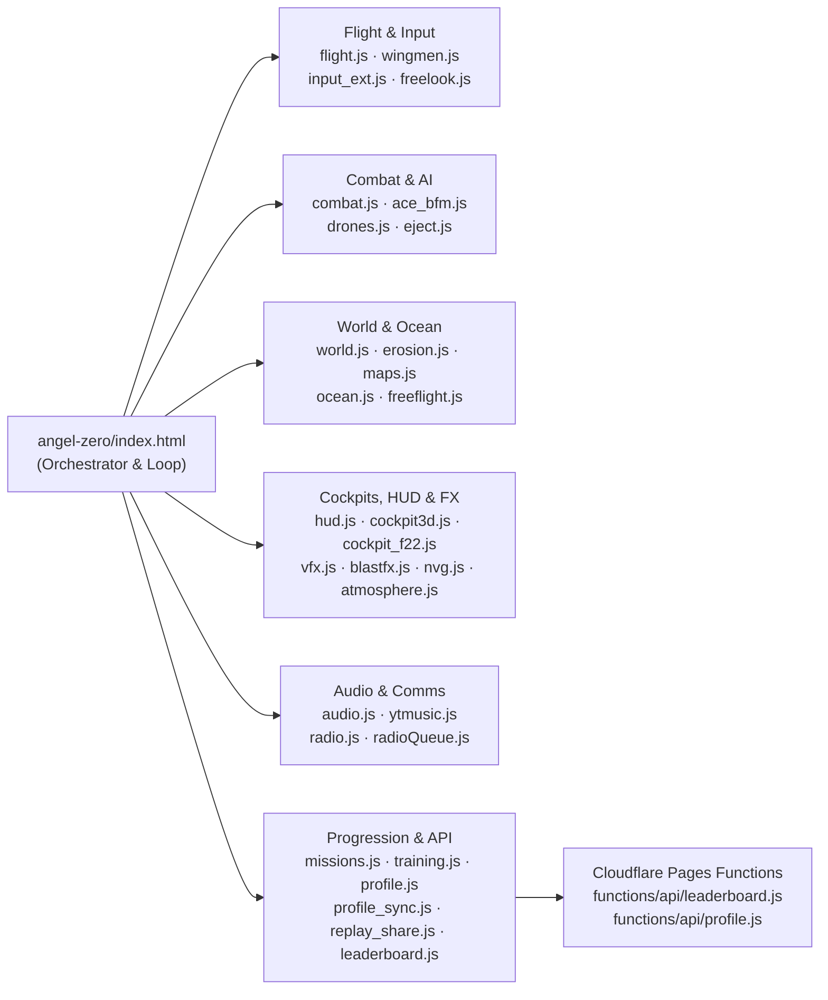

# ANGELS ZERO — Codebase Documentation (`v1.1.90`)

> **Tech Stack:** Zero-build Vanilla ES Modules · Three.js `r160` (WebGL2 + Half-Float HDR `EffectComposer`) · Procedural Web Audio + F-22A/F-15C Soundbanks · Hi-DPI 2D Tactical HUD Canvas · Cloudflare Pages + Pages Functions (KV).

---

## 1. High-Level Architecture

ANGELS ZERO runs directly from `angel-zero/index.html` with no bundler or build step. `index.html` acts as the thin orchestrator owning the Three.js `scene` / `camera` / `renderer`, DOM UI (`#sbUI`, `#debrief`, `#ctrlOverlay`, `#patchOverlay`), input listeners, and the `requestAnimationFrame` loop. All domain subsystems are cleanly factored into **44 ES modules** under `angel-zero/src/` instantiated via `create*(THREE, env)` factory functions.



---

## 2. Repository Layout

```text
.
├── .github/workflows/
│   ├── deploy.yml                 # Cloudflare Pages deployment from angel-zero/
│   ├── smoke.yml                  # Automated Playwright Chromium smoke suite on push/PR
│   └── release.yml                # Automated GitHub Release creation on v* tags
├── angel-zero/                    # Deployable web root (angels-zero.pages.dev)
│   ├── index.html                 # Main entry point, DOM overlays, GLTF boot & game loop
│   ├── src/                       # 44 modular ES6 subsystems
│   ├── functions/api/             # Cloudflare Pages Functions (leaderboard, profile sync)
│   ├── assets/
│   │   ├── angels_zero_f22.glb    # F-22A Raptor airframe GLB
│   │   ├── f22_cockpit.glb        # Blender-sculpted F-22A all-glass cockpit GLB
│   │   ├── angels_zero_jet.glb    # Normalized F-15C Eagle airframe GLB
│   │   ├── models/uss_enterprise.glb
│   │   ├── portraits/             # Phosphor CRT pilot & AWACS portraits
│   │   ├── sfx/                   # F-22A (29-file F119 bank), F-15C & environment SFX (credits: sfx/CREDITS.md)
│   │   ├── voicelines/radio/      # Legacy radio voice clips — no longer played (radio is text-only since v1.1.51)
│   │   └── CREDITS.md             # Model & technique credits (F-22A CC BY 4.0, ZyFou/ProceduralTerrains MIT)
│   ├── scripts/                   # Asset pipelines, release-note extractor & CI smoke suite
│   ├── PLAN.md                    # Roadmap, milestone history & debug flags
│   └── AGENTS.md                  # Asset & code conventions
├── docs/screenshots/              # README screenshots & animated WebP gameplay clips
├── smoke_vendor/                  # Vendored three.js r160 served to the smoke suite (CI never hits unpkg)
├── launch.bat / launch.sh         # One-click local launchers
├── server.py                      # Multi-threaded local Python HTTP server
├── CODEDOCS.md                    # This developer reference
├── CODEBASE_MAP.md                # Detailed symbol & line index
├── PROJECT.md                     # Historical architecture & pipeline notes
└── README.md                      # Public project overview
```

---

## 3. Complete Module Reference (`angel-zero/src/` — 44 Modules)

### A. Flight Physics, Input & Wingmen
| Module | Lines | Primary Exports | Responsibility |
| :--- | ---: | :--- | :--- |
| `src/flight.js` | 531 | `createFlightPhysics` | 6-DOF aerodynamics, CAS AoA limiter, Mach stiffening, high-AoA wing rock, flat spin, PSM (Cobra/Kulbit/Hammerhead), cloud icing, auto-gear/ILS assist, carrier trap & runway landing/taxi/pit-stop physics |
| `src/wingmen.js` | 113 | `createWingmenFlight` | Warden wingmen bank-to-turn (`flyBTT`) kinematics across `FORM`, `BREAK`, `FOCUS`, `COVER`, `REJOIN`, and `limping` modes |
| `src/input_ext.js` | 202 | `createInputExt` | Gamepad API (standard dual-stick/HOTAS, deadzone, cubic curve, dual-rumble haptics) + auto-detected mobile touch HUD (`#touchHUD`) |
| `src/freelook.js` | 164 | `createFreeLook` | Hold-to-orbit (`Alt` / middle-click) cockpit & chase free-look with spring return |
| `src/gear.js` | 106 | `GEAR_H`, `GEAR_PTS`, `GEAR_UNITS`, `setGearPoints`, `createGear` | Procedural tricycle landing gear & tailhook animation sized per airframe (`F15C` / `F22A`) |
| `src/surfaces.js` | 115 | `createSurfaces` | Articulated ailerons, flaperons, stabilators, canted rudders, dorsal speedbrake & variable exhaust nozzles |

### B. Combat, AI & Countermeasures
| Module | Lines | Primary Exports | Responsibility |
| :--- | ---: | :--- | :--- |
| `src/combat.js` | 6,346 | `createCombat`, `carrierReady`, `CAT_VEND`, `CAT_ARM_T`, `CAT_BOW`, `CAT_WAIST`, `WING_CAT_DT` | Core dogfight engine: player/enemy missile guidance (`MSL`, `4AAM`, `QAAM`, `UGB`), Vulcan cannon, SAM/AAA/fleet combat, flares/chaff/ECM, carrier catapults & `pitStop()` |
| `src/ace_bfm.js` | 182 | `createAceBFM` | Shared `flyBTT` integrator + Ace BFM state machine (`HIGH_YOYO`, `BREAK_SCISSORS`, `COBRA` trap, `DRAG`/`BAG` pair coordination) |
| `src/drones.js` | 335 | `createDroneSwarm` | Pooled agile drone swarm (`spawnSwarm`, `killDrone`, `updateDrones`) for Canyon Run & Naval Battle |
| `src/eject.js` | 172 | `createEjection` | Manual/auto ejection sequence, canopy jettison, steerable parachute descent & rescue |
| `src/difficulty.js` | 60 | `DIFFICULTY_KEY`, `DIFFICULTY_ORDER`, `DIFFICULTY_PRESETS`, `loadDifficulty`, `saveDifficulty` | `ROOKIE`, `NORMAL`, `ACE` CombatDirector scaling |

### C. World, Terrain, Ocean & Real-World Free Flight
| Module | Lines | Primary Exports | Responsibility |
| :--- | ---: | :--- | :--- |
| `src/world.js` | 2,033 | `WORLD`, `RWY`, `createWorld` | Builds & caches `ARCHIPELAGO`, `STRAIT`, and `GORGE` theatres: heightfields, `heightAt(x, z)`, AFB runway/PAPI/traffic, Port City, Crater Citadel, bridges, plus triplanar slope-gated PBR terrain shader (`terrainMat`) |
| `src/erosion.js` | 497 | `EROSION_DEFAULTS`, `erodeGrid` | Deterministic CPU geological sculpting (ridged spires, incised valleys, coves) + hydraulic droplet & thermal talus erosion (`aErosion` cavity/sediment/flow attribute) with zero-delta protected masks |
| `src/maps.js` | 115 | `FT`, `SEA_FLOOR_Y`, `GORGE_FLOOR_Y`, `GORGE_Z0`, `GORGE_X0`, `GORGE_HALF_W`, `gorgeCentreX`, `gorgeSlope` | Map metadata & canyon geometry helpers referenced by `MISSIONS[].mapTag` |
| `src/ocean.js` | 185 | `createOcean` | 116 km camera-snapped Gerstner + GGX specular ocean with Beer-Lambert coastal bathymetry, turquoise shoals, caustics & shoreline foam |
| `src/freeflight.js` | 1,396 | `FREE_FLIGHT_PRESETS`, `geocodePlace`, `createFreeFlight`, `loadFreeFlightCity`, `saveFreeFlightCity`, `loadCustomPlace`, `saveCustomPlace` | Streaming `5x5` real-world terrain (AWS Terrarium), satellite imagery (ESRI), 3D OSM buildings & runways (OpenFreeMap MVT), 3D landmarks, plus Nominatim any-city search |
| `src/ambient.js` | 555 | `createAmbient` | Living-world layer: dynamic beacons, shipping wakes, ambient air/ground traffic & phase lighting |

### D. Cockpits, HUD, VFX & Post-Processing
| Module | Lines | Primary Exports | Responsibility |
| :--- | ---: | :--- | :--- |
| `src/hud.js` | 2,905 | `createHUD` | Hi-DPI 2D canvas HUD: Chase reticle, Combiner Cockpit HUD, **AC7 Nose Cam HUD (`drawNoseAC7HUD`)**, tactical radar, target brackets, RWR, training card, multiplayer markers & debrief map |
| `src/cockpit3d.js` | 1,354 | `createCockpit3D` | Procedural 3D F-15C cockpit with 16 live analog gauges, animated HOTAS & 3-page VSD MFDs (`[` / `]`) |
| `src/cockpit_f22.js` | 482 | `createCockpitF22` | Blender-modeled F-22A all-glass 3D cockpit (`f22_cockpit.glb`) with 6 live glass displays (`APG-77 AESA`, `TSD`, `ALR-94 EW`, twin `UFDs`, lower stores), ICP & animated HOTAS |
| `src/canopy.js` | 136 | `createCanopyFX` | 2D canopy condensation / cloud moisture overlay |
| `src/canopyglass.js` | 346 | `createCanopyGlass` | Physical 3D bubble canopy glass shader (glare, raindrops, frost, crack damage) |
| `src/vfx.js` | 1,901 | `createVFX` | 24-step Beer-Powder volumetric cloud sea + sculpted cauliflower cumulus banks, F-22A 2D TVC / F-15C afterburner plumes, wingtip/chine vapor, Mach cone, contrails & sea-skim spray |
| `src/blastfx.js` | 593 | `createBlastFX` | Pooled missile/bomb/aircraft impact detonations & shockwaves |
| `src/atmosphere.js` | 458 | `PRESETS`, `PRESET_ORDER`, `createAtmosphere` | Rayleigh/Mie sky dome, high-altitude cirrus veil, luminous horizon glow, sun/moon corona, stars & lighting presets: random-roll `DAWN`, `DAYLIGHT`, `GOLDEN_HOUR`, `DUSK`, `NIGHT` (`PRESET_ORDER`) plus theatre / phase presets `CLOUD_SEA`, `STORM`, `STORM_OPS` (moonlit storm, drives god rays; NAVAL_BATTLE phase 3), `SUNBREAK`; global `EXPOSURE_TRIM` 1.05 over ACES |
| `src/weather.js` | 203 | `WEATHER`, `WEATHER_ORDER`, `createWeather` | Dynamic weather (`CLOUD_SEA`, `CLEAR`, `SCATTERED`, `OVERCAST_RAIN`, `THUNDERSTORM`, `STORM_OPS`), rain, lightning & gusts. `CLOUD_SEA` and `STORM_OPS` are theatres: selecting either on STANDBY → Weather / Time selects the matching lighting preset too; `STORM_OPS` is never rolled at random |
| `src/stormfx.js` | 118 | `createStormFX` | Three additive axis-locked god-ray shafts rising from the sea toward the moon/sun to the 2,300 m cloud base; strength from the preset's `shafts` (STORM_OPS = 1) |
| `src/wetdeck.js` | 253 | `createWetDeck` | Wet flight deck for CVN-ALLY *Overlord*: deck roughness / albedo / normal response driven by wetness (NAVAL ops, rain, storm), additive reflection streaks under the amber deck-edge lights, three orange island beacons and the player's nozzles |
| `src/nvg.js` | 233 | `BLOOM_THRESHOLD`, `createNVG` | Half-float HDR `EffectComposer` (`UnrealBloomPass` at threshold `BLOOM_THRESHOLD` 0.88 so only HDR emissives bloom + `OutputPass` + AC7 filmic `gradePass` + G-LOC `gPass`) and Gen-3 green phosphor AN/AVS-9 Night Vision (`N`) |
| `src/livery.js` | 182 | `createLivery` | Live F-15C squadron livery & unlockable paint shader/material applier |

### E. Audio, Radio & YouTube Music
| Module | Lines | Primary Exports | Responsibility |
| :--- | ---: | :--- | :--- |
| `src/audio.js` | 2,341 | `createAudio` | Batched SFX preloader (F-22A 29-file F119 bank + F-15C bank), procedural Web Audio DSP fallback, radio squelch / ducking chain, cockpit voice warnings (F-15C "Betty" and F-22A VWS samples: over-G, bingo, pull-up, chaff/flare) & RWR tones, `textLineSecs()` reading time for text radio |
| `src/ytmusic.js` | 166 | `createYouTubeMusic` | YouTube / YouTube Music IFrame Playlist controller (URL/ID parser, presets, shuffle, radio ducking, embed-error auto-skip, `localStorage` persistence) |
| `src/radio.js` | 168 | `createRadio` | Reactive tactical radio watcher (telemetry events → AWACS / wingman / bandit callouts shown as text on the CRT radio box; no voice) |
| `src/radioQueue.js` | 145 | `PRI`, `GAP_S`, `CD`, `LINE_CD`, `TTL`, `Q_N`, `createRadioQueue` | Zero-allocation priority radio queue |
| `src/radioScript.js` | 136 | `RADIO_SPEAKERS`, `RADIO_EVENTS`, `RADIO_LINES`, `RADIO_BY_EVENT`, `RADIO_HERO` | 45+ radio script lines & speaker profiles (rendered as text; the clip paths into `assets/voicelines/radio/` are legacy and not played) |

### F. Missions, Training, Progression & Social
| Module | Lines | Primary Exports | Responsibility |
| :--- | ---: | :--- | :--- |
| `src/missions.js` | 115 | `MISSION_KEY`, `MISSIONS`, `MISSION_ORDER`, `missionConfig`, `loadMission`, `saveMission` | Mission registry (`AIR_SUPERIORITY`, `NAVAL_BATTLE`, `CANYON_RUN`, `ACE_DUEL`, `FURBALL`, `FREE_FLIGHT`, `TRAINING`) |
| `src/training.js` | 109 | `createTraining` | Guided 6-step flight & weapons qualification state machine (`THROTTLE` → `BANK` → `CAMERA` → `LOCK_FIRE` → `FLARE` → `GUN_PASS`) |
| `src/loadout.js` | 50 | `SPW_KEY`, `ROLE_KEY`, `ROLE_LABELS`, `MODES`, `SPW`, `SQUADRON`, `loadSPW`, `saveSPW`, `loadLivery`, `saveLivery`, `loadMode`, `saveMode`, `loadRoles`, `saveRoles` | Persistent special weapons (`4AAM`, `UGB`, `QAAM`), wingman roles & squadron loadouts |
| `src/profile.js` | 116 | `PROFILE_KEY`, `BW_KEY`, `RANKS`, `RANK_SCORE`, `LIVERIES`, `liveryById`, `createProfile` | Persistent pilot service record, S/A/B/C rank calculation & livery unlocks |
| `src/profile_sync.js` | 173 | `collectPilotSnapshot`, `applyPilotSnapshot`, `exportPilotCode`, `importPilotCode`, `pushCloudProfile`, `pullCloudProfile`, `getSyncId`, `setSyncId`, `generateSyncId` | Offline `AZP1:` pilot code export/import + anonymous `AZ-XXXX-XXXX` cloud sync with high-water-mark merging |
| `src/telemetry.js` | 61 | `TELE_MAX`, `EV`, `createTelemetry` | Fixed-size circular telemetry buffer (`15 min` trace + combat event markers) for Debrief map |
| `src/replay_share.js` | 181 | `encodeReplay`, `decodeReplay`, `buildReplayUrl` | Deflate + Base64URL encoder/decoder for backend-free `?replay=` share links |
| `src/leaderboard.js` | 67 | `fetchLeaderboard`, `submitScore` | Global leaderboard client with automatic `localStorage` (`az_local_board`) fallback |
| `src/patchnotes.js` | 547 | `PATCH_NOTES`, `renderPatchNotes` | Versioned changelog (`PATCH_NOTES[0].version` drives `#buildChip` & release tags) |

---

## 4. Cloudflare Pages Functions (`angel-zero/functions/api/`)

| Endpoint | File | KV Binding | Behavior |
| :--- | :--- | :--- | :--- |
| `GET / POST /api/leaderboard` | `functions/api/leaderboard.js` | `env.AZ_LEADERBOARD` | Returns top 25 scores per mission; validates submissions (`score <= 500000`, rate-limited 1/15s per IP). Returns `503 { offline: true }` if KV is unbound (client falls back to `localStorage`). |
| `GET / PUT /api/profile` | `functions/api/profile.js` | `env.AZ_PROFILES` | Stores/fetches `AZ-XXXX-XXXX` pilot profile snapshots (`<= 16 KB`, 365-day TTL). Returns `503 { offline: true }` if KV is unbound. |

---

## 5. Runtime Loop & Engineering Invariants

### Frame Pipeline (`animate` → `stepSim`)
1. **Input & Flight:** `inputExt.update(dt)` (gamepad/touch) → `flight.updatePhysics(dt)` (6-DOF/PSM/ground/pit-stop).
2. **Combat & AI:** `combatSys.update(dt, simTime, opts)` (`ace_bfm.js`, `drones.js`, missiles, countermeasure rolls) → `wingmenFlight.updateWingmanFlight(dt, flags)`.
3. **Camera & World:** `updateCameraAndVisuals(dt, now)` (Chase/Cockpit/Nose/Missile-Cam/Padlock/Shake) → `ocean.followOcean()` → `world.update(...)` / `freeFlight.update(...)` → `vfx.update(...)` → `atmosphere.update(...)`.
4. **Render:** `nvg.render(scene, camera, simTime, firstPerson)` (WebGL2 HDR Composer + Bloom + AC7 Grade / NVG) → `hud.draw()` (2D Canvas overlay).

### Critical Rules
- **Zero Per-Frame Allocations:** Never allocate `THREE.Vector3`, `Quaternion`, `Matrix4`, arrays, or objects inside `update()` / `draw()` loops; use preallocated module-scope scratches.
- **`heightAt(x, z)` Sync:** Terrain erosion (`erosion.js`) mutates the height grid before `computeVertexNormals()`, `gridCache`, and `buildDepthTexture()` so physics collisions, AI terrain avoidance, SAM placement, and ocean depth always match the rendered mesh.
- **Cache-Busting (`?v=`):** CDN edges cache ES modules aggressively; always bump the `?v=` query parameter on edited imports in `angel-zero/index.html` and intra-`src/` imports, prepend an entry in `src/patchnotes.js`, and keep `window.__az` hooks intact.

---

## 6. Scripts, Verification & `?debug` Hooks

### Scripts (`angel-zero/scripts/`)
- `smoke_test.mjs`: 18-scenario headless Playwright Chromium suite (`AIR_SUPERIORITY`, `NAVAL_BATTLE`, `CANYON_RUN`, `ACE_DUEL`, `FURBALL`, `FREE_FLIGHT`, `TRAINING`, F-22A 3-way camera cycle, Wingman BTT, Ace BFM, Pit-Stop, Gamepad/Touch, Profile round-trip, Replay sharing, `warp=3`). Run via `node angel-zero/scripts/smoke_test.mjs`.
- `extract_release_notes.mjs`: Extracts Markdown release notes for a tag from `src/patchnotes.js`.
- Asset pipeline scripts: `prep_f15.py`, `prep_f22.py`, `build_jet.py`, `build_f22_cockpit.py`, `optimize_carrier.py`, `make_portraits.py`, `radio_voice_pass.py`.

### Useful `?debug` Query Parameters
- `?debug&nointro` — Skip Standby directly into active sortie (`?mission=AIR_SUPERIORITY|NAVAL_BATTLE|CANYON_RUN|ACE_DUEL|FURBALL|FREE_FLIGHT|TRAINING`).
- `?aircraft=F22A|F15C`, `?cockpit`, `?nose` — Force airframe and starting camera mode.
- `?tod=CLOUD_SEA|DAYLIGHT|DAWN|GOLDEN_HOUR|DUSK|NIGHT|STORM_OPS`, `?wx=CLOUD_SEA|CLEAR|SCATTERED|OVERCAST_RAIN|THUNDERSTORM|STORM_OPS` — Force lighting/weather (`?tod` accepts any `PRESETS` key, e.g. `STORM`, `SUNBREAK`).
- `?warp=N` — Fast-forward `N` seconds deterministically and dump `[ANGELS_ZERO] warp` telemetry.
- `?wingphys=1`, `?aceonsix=s`, `?yoyoat=s`, `?acemslat=s:IR|RADAR`, `?pairat=s`, `?pitstoptest=1`, `?touch=1`, `?debrief=CLEARED` — Deterministic subsystem test hooks.
