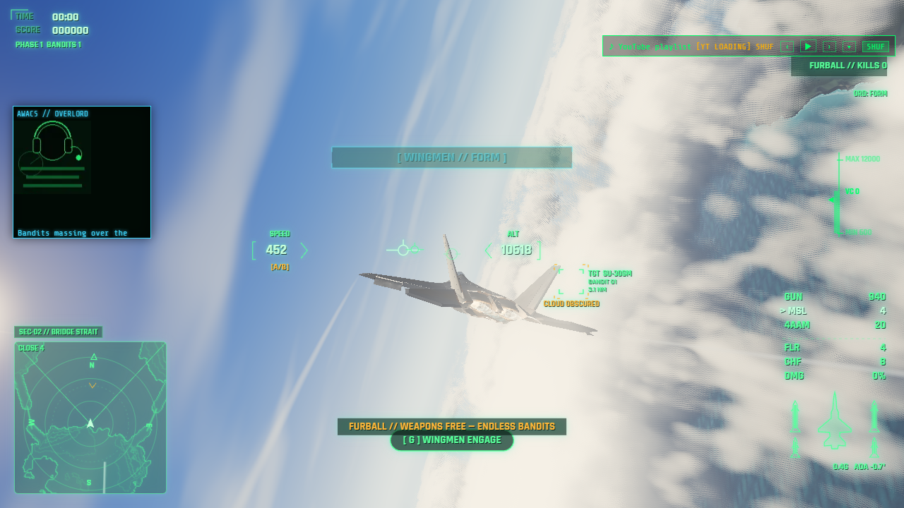
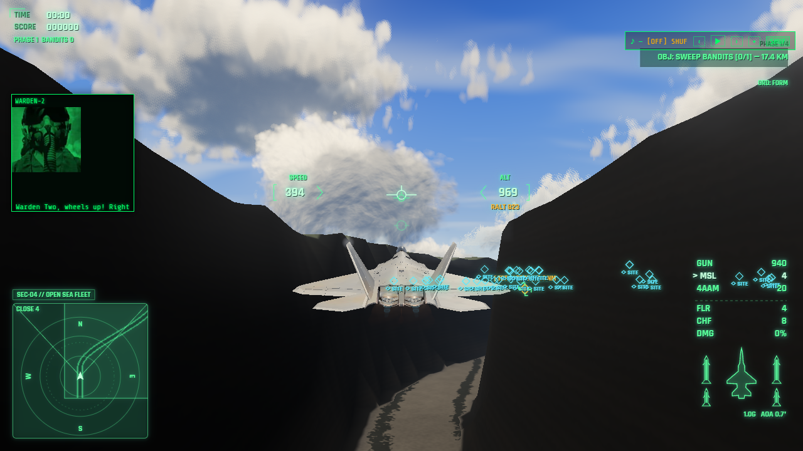

<div align="center">

# ANGELS ZERO

**Ace Combat-style 3D F-15C Eagle dogfight & strike simulator — playable right in your browser, zero installs.**

[](https://angels-zero.pages.dev/)
[](angel-zero/src/patchnotes.js)
[](https://threejs.org/)
[](LICENSE)

<h3><a href="https://angels-zero.pages.dev/">PLAY IN BROWSER</a></h3>



</div>

---

## Core Systems

| System | Capabilities |
| :--- | :--- |
| **Game Modes** | 5 selectable missions (*Air Superiority, Naval Battle, Canyon Run, Ace Duel, endless Furball*) + USS Enterprise bow catapult launch & arrestor recovery |
| **Post-Stall Maneuvering** | Decoupled AoA for **Cobra**, **Kulbit**, **Hammerhead**, flat spins, Mach-1 shock cones & pilot G-LOC |
| **3D F-15C Cockpit** | Live 16-dial analog panel, animated HOTAS, bubble canopy rain/glare & cyclable VSD MFDs (`[` / `]`) |
| **Voiced Radio & CRT Portraits** | 45 radio-filtered voice lines across **AWACS Overlord**, **Warden** wingmen & **Crimson** aces |
| **Arsenal & Countermeasures** | M61A1 Vulcan, AIM-9M, 4AAM, QAAM, CCIP/CCRP bombs, flares, chaff, ECM jammer, missile cam & ejection |
| **Weather, NVG & Debrief** | Dawn-to-night skies, thunderstorms, AN/AVS-9 night vision (`N`) & animated **S/A/B/C** flight trace replay |

---

## Screenshots

<table>
  <tr>
    <td width="50%">
      
      <p align="center"><strong>Borderless Standby Hangar</strong><br /><sub>Live 3D F-15C orbit with mode, SPW, squadron livery & weather/time selectors</sub></p>
    </td>
    <td width="50%">
      
      <p align="center"><strong>3D Cockpit & Cyclable VSD MFDs</strong><br /><sub>Collimated combiner HUD, bubble canopy, animated HOTAS & live tactical radar</sub></p>
    </td>
  </tr>
  <tr>
    <td width="50%">
      
      <p align="center"><strong>Low-Altitude Canyon Strike</strong><br /><sub>Thread sheer canyon walls below 500 ft to beat enemy EW radar jamming</sub></p>
    </td>
    <td width="50%">
      
      <p align="center"><strong>AN/AVS-9 Night Vision (<code>N</code>)</strong><br /><sub>Gen-3 green phosphor amplification with contour edges & HDR halo bloom</sub></p>
    </td>
  </tr>
  <tr>
    <td colspan="2" align="center">
      
      <p align="center"><strong>Animated Tactical Trace Debrief</strong><br /><sub>15-minute flight path replay with kill/ace/strike/trap markers & composite S/A/B/C score</sub></p>
    </td>
  </tr>
</table>

---

## Fly in 30 Seconds

| Input | Action | Input | Action |
| :--- | :--- | :--- | :--- |
| **Mouse / WASD** | Pitch & roll | **C** | Lock missile seeker / cycle target |
| **Shift / Ctrl / Wheel** | Throttle ± & Afterburner | **X / Z** | Deploy flares / chaff |
| **Q / E** | Rudder yaw | **Space** | Toggle 3D Cockpit / Chase camera |
| **LMB / RMB** | Vulcan cannon / Fire missile *(hold: Missile Cam)* | **N / H** | Night Vision (NVG) / Pause & Controls |

<details>
<summary><strong>Full Controls Reference (PSM, Wingmen, MFDs, Carrier Ops)</strong></summary>

#### Flight & Post-Stall Maneuvering
| Input | Action |
| :--- | :--- |
| **Mouse / W A S D** | Pitch & roll (`W/S` pitch, `A/D` roll, smoothly blends with mouse aim) |
| **Shift / Ctrl / ↑ / ↓ / Wheel** | Throttle up / down; `Shift` at full throttle lights Afterburner & assists High-G pulls (`B+Shift` < `290 kt` = PSM Cobra/Kulbit) |
| **Q / E** | Rudder yaw (and parachute steering after ejection) |
| **V** | Evasive `360°` barrel roll |
| **B** | Dorsal speedbrake / wheel brakes |
| **L** | Landing gear / tailhook toggle (`[L]` autoland on carrier finals; forgiving deck/runway traps) |

#### Combat, Weapons & Wingmen
| Input | Action |
| :--- | :--- |
| **Left-Click / F** | M61A1 20mm Vulcan cannon (if engine fire: `F` = Halon bottle, hold `F` = windmill relight) |
| **Right-Click / M** | Fire selected weapon (`MSL` / `4AAM` / `QAAM` / drop `UGB`; hold = Missile Cam) |
| **R · 1 / 2 / 3** | Cycle or select `MSL` / `4AAM` / `UGB` / `QAAM` |
| **C** | Lock missile seeker / cycle target inside sight cone |
| **X / Z / J** | Flares (`X`, IR decoys) · Chaff (`Z`, >2.5 km radar decoys) · ALQ-135 ECM Jammer (`J`) |
| **G** | Toggle Warden wingmen formation / engage |

#### Camera, Avionics & Sortie Controls
| Input | Action |
| :--- | :--- |
| **Space** | Toggle 1st-person 3D Cockpit / 3rd-person Chase camera |
| **Alt / Middle-Click** | Free Look (hold + drag mouse; springs back on release) |
| **[ / ]** | Cycle cockpit VSD MFD page (`TACTICAL RADAR` / `STORES & DMG` / `RWR THREAT SCOPE`) |
| **N / K** | Toggle Night Vision (`N`) / Combat music on-off (`K`) |
| **, / . / /** | Music previous track / next track / toggle AUTO shuffle |
| **F1 / Tab Tab** | In-flight keybind cheat-sheet (`F1`) / End sortie to Debrief (`Tab` twice) |
| **P / H / Backspace** | Eject (`P`) · Pause & Settings (`H` / `Esc`) · Reset (`Backspace`) |

</details>

---

## Run Locally

No build step or dependencies needed—just serve `angel-zero/` over HTTP:

- **Windows:** double-click `launch.bat`
- **macOS / Linux:** `chmod +x launch.sh && ./launch.sh`
- **Manual (Python 3):** `python server.py` → opens at `http://127.0.0.1:8090/`

<details>
<summary><strong>Repository Structure & Tech Stack</strong></summary>

Built with **vanilla ES modules + Three.js r160**, a **Blender 5.3 headless GLB pipeline**, and **procedural Web Audio + radio-filtered voice lines**:

```text
.
├── .github/workflows/deploy.yml   # Cloudflare Pages deployment from angel-zero/
├── angel-zero/                    # Deployable game root (angels-zero.pages.dev)
│   ├── index.html                 # Orchestrator: WebGL2, 6-DOF + PSM physics, STANDBY & Debrief UI
│   ├── src/                       # 24 vanilla ES modules (hud, cockpit3d, combat, audio, vfx, nvg, ...)
│   ├── assets/
│   │   ├── angels_zero_jet.glb    # Normalized 19.4 m F-15C GLB (11.5 MB, 16 ordnance nodes)
│   │   ├── portraits/             # 6 phosphor CRT pilot & AWACS portraits (< 20 KB)
│   │   ├── sfx/                   # Supplemental CC0 audio textures
│   │   └── voicelines/radio/      # 45 mono radio-filtered voice clips (0.92 MB)
│   ├── scripts/                   # prep_f15.py (Blender), make_portraits.py, radio_voice_pass.py
│   ├── PLAN.md                    # Roadmap, milestone log & ?debug URL flags
│   └── AGENTS.md                  # Asset pipeline conventions
├── docs/screenshots/              # Gameplay screenshots for README
├── launch.bat / launch.sh         # One-click local launchers
├── server.py                      # Zero-dependency local HTTP server
├── PROJECT.md                     # Full 24-module architecture & pipeline documentation
└── LICENSE                        # MIT License
```

See [PROJECT.md](PROJECT.md) for the complete 24-module breakdown and [angel-zero/PLAN.md](angel-zero/PLAN.md) for headless `?debug` flags.

</details>

---

Released under the [MIT License](LICENSE).
