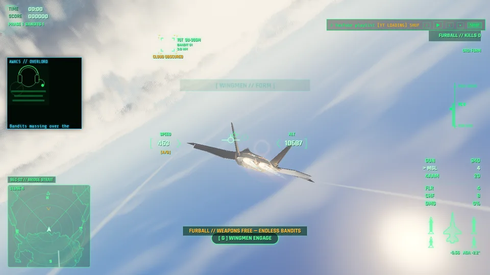
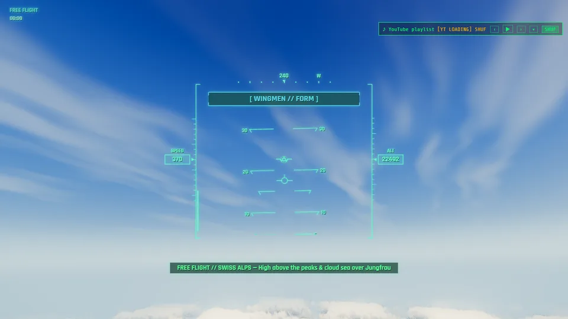
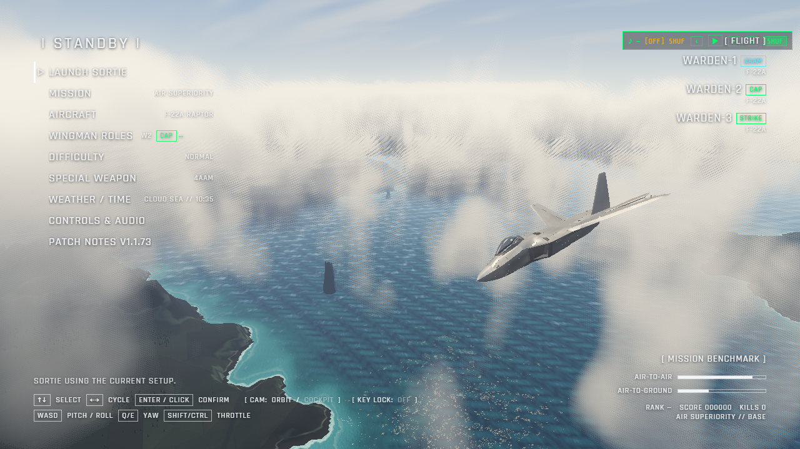
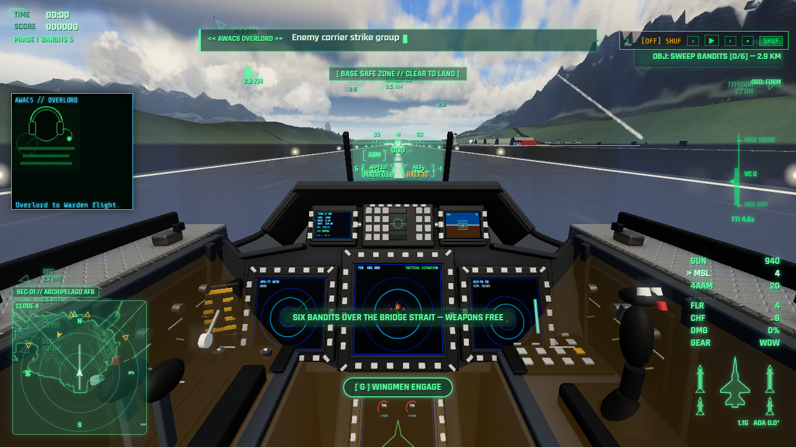
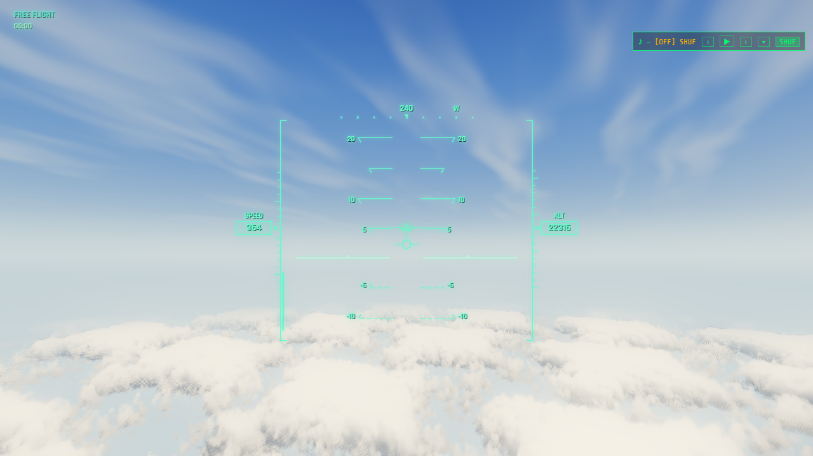
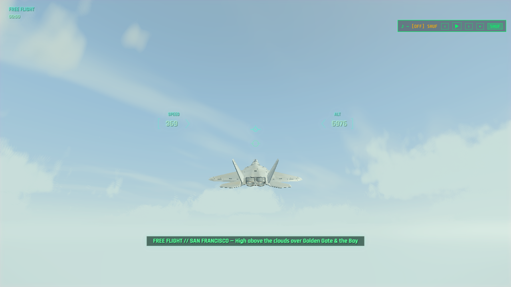

<div align="center">

# ANGELS ZERO

**Ace Combat-inspired 3D F-22A Raptor & F-15C Eagle dogfight, strike & free-flight simulator — playable right in your browser, zero installs.**

[](https://angels-zero.pages.dev/)
[](angel-zero/src/patchnotes.js)
[](https://github.com/duyanh-nguyen-ngoc/angels-zero/releases)
[](https://threejs.org/)
[](LICENSE)

<h3><a href="https://angels-zero.pages.dev/">PLAY IN BROWSER</a></h3>


</div>

---

## Live Gameplay Footage

<table>
  <tr>
    <td width="50%">
      
      <p align="center"><strong>F-22A Raptor Dogfight &amp; Cloud Sea</strong><br /><sub>2D rectangular TVC plumes, AC7 dreamy HDR bloom, volumetric cumulus sea &amp; cirrus sky</sub></p>
    </td>
    <td width="50%">
      
      <p align="center"><strong>Ace Combat 7 Nose Camera HUD</strong><br /><sub>Cyan-mint bracketed HUD-only nose view with gull-wing boresight &amp; rolling compass</sub></p>
    </td>
  </tr>
</table>

---

## Core Systems (`v1.1.73`)

| System | Capabilities |
| :--- | :--- |
| **Flyable Fighters** | **F-22A Raptor** (supercruise, 2D TVC agility, stealth RCS, APG-77 AESA lock, 29-file F119 soundpack) &amp; **F-15C Eagle** (selectable squadron liveries) |
| **3-Way Camera &amp; HUD** | Cycle **Chase → 3D Cockpit → Nose Cam (`Space`)** featuring an **Ace Combat 7 HUD-only Nose View** with bracketed tapes, throttle bar &amp; dotted compass |
| **Sculpted 3D Cockpits** | **F-22A Blender-sculpted all-glass pit** (6 live displays, ICP, animated side-stick &amp; twin throttles) + **F-15C 16-dial analog panel** with cyclable MFDs (`[` / `]`) |
| **6 Theatres &amp; Free Flight** | *Air Superiority, Naval Battle (fjord strait), Canyon Run (Crater Citadel &amp; bridges), Ace Duel, endless Furball,* &amp; **Unarmed Real-World Free Flight** (Toronto, Tokyo, San Francisco, New York, Swiss Alps) |
| **Ace BFM &amp; Wingman BTT** | Real bank-to-turn (`flyBTT`) wingmen (`FORM / COVER / FOCUS`) &amp; **CRIMSON-1 / CRIMSON-2** Ace AI with `HIGH_YOYO`, `BREAK_SCISSORS`, Cobra traps, bracket/drag-and-bag &amp; smart flares/chaff/notch |
| **Volumetric Clouds &amp; HDR** | 24-step Beer-Powder volumetric cloud sea, towering cumulus congestus turrets, high-altitude cirrus streaks, AC7 split-tone filmic grade &amp; AN/AVS-9 Night Vision (`N`) |
| **YouTube / YT Music Player** | Built-in top-right **YouTube &amp; YouTube Music playlist player** (`‹ / ▶ / › / ▾ / SHUF`), custom URL paste &amp; persistence, automatic radio ducking &amp; embed-error skip |
| **Post-Stall &amp; Carrier Ops** | Decoupled AoA for **Cobra / Kulbit** (`B+Shift` &lt; 290 kt), flat spins, Mach-1 cone, USS Enterprise bow catapult &amp; arrestor recovery, voiced radio + CRT portraits, &amp; Auto-Fullscreen Shortcut Lock |

---

## Screenshots

<table>
  <tr>
    <td width="50%">
      
      <p align="center"><strong>Standby Hangar &amp; F-22A Raptor</strong><br /><sub>Live 3D orbit over the cloud sea with aircraft, mission, SPW, wingman role, weather &amp; Key Lock selectors</sub></p>
    </td>
    <td width="50%">
      
      <p align="center"><strong>F-22A Sculpted All-Glass 3D Cockpit</strong><br /><sub>Blender-modeled glare shield, ICP keypad, APG-77 AESA, TSD, ALR-94 EW, animated HOTAS &amp; wide HUD combiner</sub></p>
    </td>
  </tr>
  <tr>
    <td width="50%">
      
      <p align="center"><strong>AC7 Nose Camera HUD (<code>Space</code>)</strong><br /><sub>Unobstructed forward nose view with cyan-mint brackets, boxed SPEED/ALT, throttle bar &amp; gull-wing boresight</sub></p>
    </td>
    <td width="50%">
      
      <p align="center"><strong>Overhauled Canyon Run Theatre</strong><br /><sub>Thread deep river gorges below 500 ft to evade EW jamming and strike the fortified Crater Citadel</sub></p>
    </td>
  </tr>
  <tr>
    <td width="50%">
      
      <p align="center"><strong>Real-World Streaming Free Flight</strong><br /><sub>High-altitude unarmed scenic flight with streaming elevation, satellite imagery, 3D OSM buildings &amp; landmarks</sub></p>
    </td>
    <td width="50%">
      
      <p align="center"><strong>AN/AVS-9 Night Vision (<code>N</code>)</strong><br /><sub>Gen-3 green phosphor amplification with contour edges, binocular mask &amp; HDR halo bloom</sub></p>
    </td>
  </tr>
  <tr>
    <td colspan="2" align="center">
      
      <p align="center"><strong>Animated Tactical Trace Debrief</strong><br /><sub>15-minute flight path replay with kill/ace/strike/trap markers &amp; composite S/A/B/C score</sub></p>
    </td>
  </tr>
</table>

---

## Fly in 30 Seconds

| Input | Action | Input | Action |
| :--- | :--- | :--- | :--- |
| **Mouse / WASD** | Pitch &amp; roll | **C** | Lock missile seeker / cycle target |
| **Shift / Ctrl / Wheel** | Throttle ± &amp; Afterburner | **X / Z** | Deploy flares / chaff |
| **Q / E** | Rudder yaw | **Space** | Cycle **Chase → 3D Cockpit → Nose Cam** |
| **LMB / RMB** | Vulcan cannon / Fire missile *(hold: Missile Cam)* | **N / H / F11** | Night Vision (`N`) · Pause (`H`) · Fullscreen Key Lock (`F11`) |

<details>
<summary><strong>Full Controls Reference (PSM, Wingmen, YouTube Music, MFDs, Carrier Ops)</strong></summary>

#### Flight &amp; Post-Stall Maneuvering
| Input | Action |
| :--- | :--- |
| **Mouse / W A S D** | Pitch &amp; roll (`W/S` pitch, `A/D` roll, smoothly blends with mouse aim) |
| **Shift / Ctrl / ↑ / ↓ / Wheel** | Throttle up / down; `Shift` at full throttle lights Afterburner &amp; assists High-G pulls (`B+Shift` &lt; `290 kt` = PSM Cobra/Kulbit) |
| **Q / E** | Rudder yaw (and parachute steering after ejection) |
| **V** | Evasive `360°` barrel roll |
| **B** | Dorsal speedbrake / wheel brakes |
| **L** | Landing gear / tailhook toggle (`[L]` autoland on carrier finals; forgiving deck/runway traps) |

#### Combat, Weapons &amp; Wingmen
| Input | Action |
| :--- | :--- |
| **Left-Click / F** | 20mm Vulcan cannon (if engine fire: `F` = Halon bottle, hold `F` = windmill relight) |
| **Right-Click / M** | Fire selected weapon (`MSL` / `4AAM` / `QAAM` / drop `UGB`; hold = Missile Cam) |
| **R · 1 / 2 / 3** | Cycle or select `MSL` / `4AAM` / `UGB` / `QAAM` |
| **C** | Lock missile seeker / cycle target inside sight cone |
| **X / Z / J** | Flares (`X`, IR decoys) · Chaff (`Z`, radar decoys) · ALQ-135 ECM Jammer (`J`) |
| **G** | Cycle Warden wingmen orders (`FORM` / `FOCUS` / `COVER`) |

#### Camera, Avionics, Music &amp; Shortcut Lock
| Input | Action |
| :--- | :--- |
| **Space** | Cycle **Chase → 3D Cockpit → AC7 Nose Cam** |
| **Alt / Middle-Click** | Free Look (hold + drag mouse; springs back on release) |
| **[ / ]** | Cycle cockpit VSD MFD page (`TACTICAL RADAR` / `STORES &amp; DMG` / `RWR THREAT SCOPE`) |
| **N / K** | Toggle Night Vision (`N`) / YouTube Music Play-Pause (`K`) |
| **, / .** | YouTube Music previous track / next track (use `▾` in top-right bar to paste any YT / YT Music playlist URL) |
| **F11 / KEY LOCK** | Toggle DOM Fullscreen + `navigator.keyboard.lock()` (auto-engaged on launch/resume to block `Ctrl+W/T/R/N` &amp; `Tab`) |
| **F1 / Tab Tab** | In-flight keybind cheat-sheet (`F1`) / End sortie to Debrief (`Tab` twice) |
| **P / H / Backspace** | Eject (`P`) · Pause &amp; Settings (`H` / `Esc`) · Reset (`Backspace`) |

</details>

---

## Run Locally

No build step or dependencies needed—just serve `angel-zero/` over HTTP:

- **Windows:** double-click `launch.bat`
- **macOS / Linux:** `chmod +x launch.sh && ./launch.sh`
- **Manual (Python 3):** `python server.py` → opens at `http://127.0.0.1:8090/`

## Testing / CI

A zero-dependency Playwright smoke suite boots the real game in headless Chromium (SwiftShader) and checks menu boot, all six missions, the F-22A 3-way camera cycle, wingman BTT, ace BFM, warp telemetry and the debrief screen for JS exceptions, 4xx/failed local asset requests, WebGL errors and `NaN` state:

```sh
npm i --no-save playwright && npx playwright install chromium
node angel-zero/scripts/smoke_test.mjs
```

The same suite runs automatically as the **Smoke Test** GitHub Action on every push and pull request to `main`, alongside **Deploy to Cloudflare Pages**. For determinism, the suite fulfills three.js r160 from the repo-root `smoke_vendor/` directory instead of hitting unpkg, and blocks YouTube/font/tile CDNs — so CI never stalls on third-party networks. The job allows 15 minutes because software-GL shader compilation on a GPU-less runner can take several minutes per cold boot. Boot loading is reported by a tactical progress HUD (percentage, MB, stage) and measured as `window.__az.bootMs`; the suite prints both F-22A and F-15C boot times locally and asserts the loading overlay is removed once the model is ready.

After a sortie, use **[ SHARE REPLAY ]** on the debrief to copy a compact link that lets friends watch your exact flight trace, kills and score. **[ SUBMIT SCORE ]** posts to the global leaderboard (when the Cloudflare KV binding is configured) and always saves a local personal board otherwise.

<details>
<summary><strong>Repository Structure &amp; Tech Stack</strong></summary>

Built with **vanilla ES modules + Three.js r160**, a **Blender headless GLB pipeline**, **YouTube IFrame Music integration**, and **procedural Web Audio + radio-filtered voice lines**:

```text
.
├── .github/workflows/deploy.yml   # Cloudflare Pages deployment from angel-zero/
│   ├── smoke.yml                  # Headless Playwright smoke suite (push + PR to main)
├── angel-zero/                    # Deployable game root (angels-zero.pages.dev)
│   ├── index.html                 # Orchestrator: WebGL2, 6-DOF + PSM physics, STANDBY & Debrief UI
│   ├── src/                       # 31 vanilla ES modules (hud, cockpit3d, cockpit_f22, combat, ytmusic, freeflight, vfx, nvg, ...)
│   ├── assets/
│   │   ├── angels_zero_f22.glb    # F-22A Raptor airframe GLB
│   │   ├── f22_cockpit.glb        # Blender-sculpted F-22A all-glass cockpit GLB
│   │   ├── angels_zero_jet.glb    # Normalized 19.4 m F-15C GLB (16 ordnance nodes)
│   │   ├── portraits/             # Phosphor CRT pilot & AWACS portraits
│   │   ├── sfx/                   # F-22A (29-file F119 bank) + F-15C & environment SFX
│   │   └── voicelines/radio/      # Radio-filtered voice clips
│   ├── scripts/                   # Blender / audio pipeline + smoke_test.mjs (headless CI smoke suite)
│   └── PLAN.md                    # Roadmap, milestone log & ?debug URL flags
├── smoke_vendor/                  # Offline three.js r160 mirror for the headless smoke suite
├── docs/screenshots/              # Screenshots & animated WebP gameplay footage for README
├── launch.bat / launch.sh         # One-click local launchers
├── server.py                      # Multi-threaded local HTTP server
├── PROJECT.md                     # Full module architecture & pipeline documentation
├── CODEBASE_MAP.md                # Symbol & hook index
└── LICENSE                        # MIT License
```

See [PROJECT.md](PROJECT.md) for the architecture breakdown, [CODEBASE_MAP.md](CODEBASE_MAP.md) for the symbol index, and [angel-zero/PLAN.md](angel-zero/PLAN.md) for headless `?debug` flags.

</details>

---

Released under the [MIT License](LICENSE).
